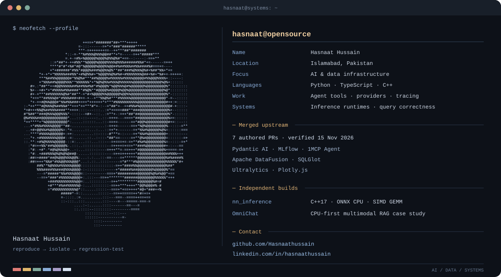

  
  

    <a href="https://hasnaat-portfolio-gilt.vercel.app/">Portfolio</a> ·
    <a href="https://www.linkedin.com/in/hasnaathussain">LinkedIn</a> ·
    <a href="https://github.com/Hasnaathussain?tab=repositories">Projects</a>
  

I build and debug AI and data infrastructure: agent tooling, model integrations, and the execution paths underneath them. My work starts with a reproducible failure and ends with a focused fix and regression coverage.

### Merged upstream work

| Project | Contribution |
| --- | --- |
| [Pydantic AI](https://github.com/pydantic/pydantic-ai/pull/6098) | Bedrock tool results with co-located attachments |
| [MLflow](https://github.com/mlflow/mlflow/pull/25807) | Strands autologging with foreign OpenTelemetry spans |
| [1MCP Agent](https://github.com/1mcp-app/agent/pull/557) | Protocol-era-aware conformance checks |
| [Apache DataFusion](https://github.com/apache/datafusion/pull/24484) | `CASE` evaluation for custom physical expressions |
| [SQLGlot](https://github.com/tobymao/sqlglot/pull/7807) | Parenthesized SQLite tuple parsing |
| [Ultralytics](https://github.com/ultralytics/ultralytics/pull/25153) | RT-DETR `max_det` in export and validation |
| [Plotly.js](https://github.com/plotly/plotly.js/pull/7768) | Exponent formatting for small tick values |

### Projects

- [nn_inference](https://github.com/Hasnaathussain/nn_inference) — C++17 ONNX CPU runtime with SIMD GEMM and activation memory planning.
- [OmniChat Showcase](https://github.com/Hasnaathussain/OmniChat-Showcase) — sanitized case study for a CPU-first multimodal RAG assistant.
